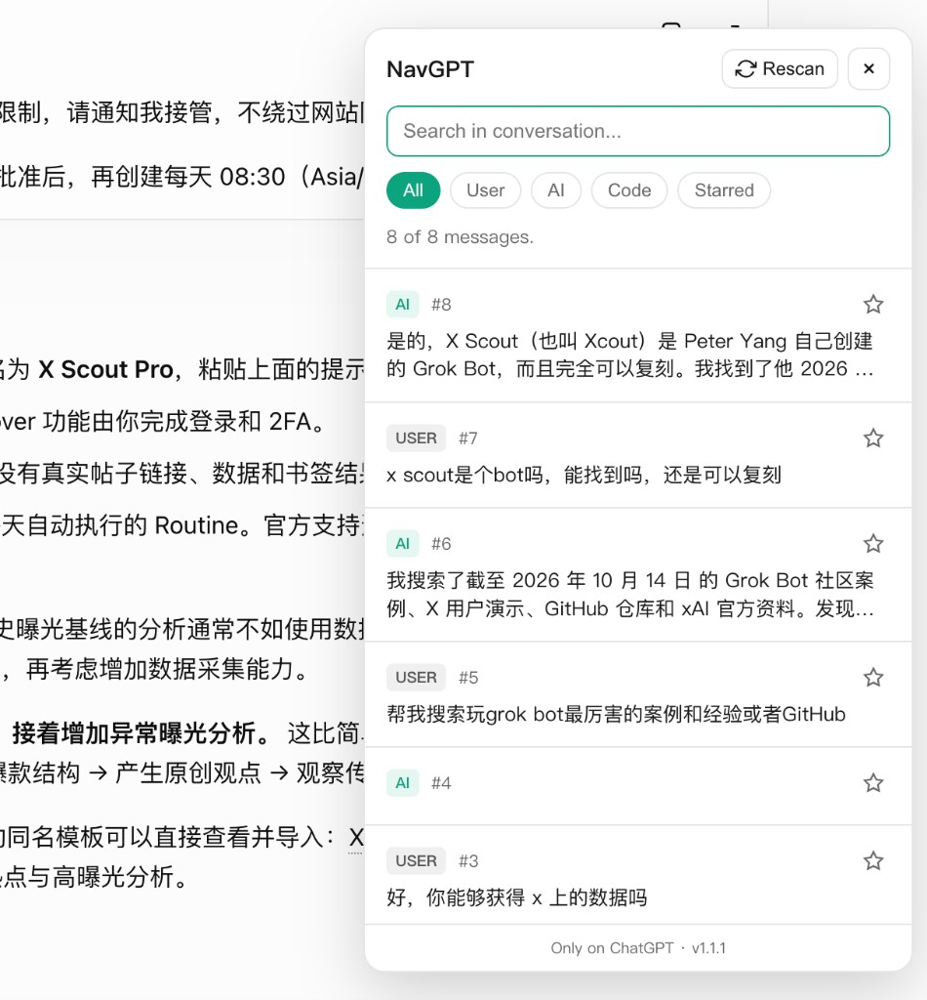

# NavGPT

轻量级 Chrome 扩展：在长 ChatGPT 对话里快速导航。

扫描当前会话、按关键词搜索、按角色 / 代码 / 收藏过滤，并一键跳转到对应消息——全部在本地浏览器完成。



## 功能

- **悬浮窗**：仅在 ChatGPT 页面显示（不是浏览器全局侧栏）
- **可拖拽 Nav 按钮**：位置会记住，下次仍在该处
- 当前对话关键词搜索
- 过滤：全部 / 用户 / AI / 代码 / 收藏
- 点击跳转并高亮
- 页面更新后可手动重新扫描
- 权限尽量少：仅 `storage` + `https://chatgpt.com/*`

## 隐私

- 无账号、无统计、无远程后端
- 消息内容只留在页面 / 扩展本地存储（如收藏、按钮位置）
- 不会把对话内容上传到任何服务器

## 在 Chrome 里安装

目前需要从源码加载（未上架 Chrome 网上应用店）：

1. 安装 [Bun](https://bun.sh)（或改用 npm / pnpm 也可）。
2. 克隆并构建：

```bash
git clone https://github.com/wukong7788/NavGPT.git
cd NavGPT
bun install
bun run build
```

3. 打开 Chrome，地址栏输入并访问：`chrome://extensions/`
4. 右上角打开 **开发者模式**
5. 点击 **加载已解压的扩展程序**
6. 选择本仓库生成的 **`dist`** 文件夹（不要选整个项目根目录）
7. 列表里出现 **NavGPT - Chat Navigator** 即表示安装成功

以后更新代码时：

1. 在项目目录再执行一次 `bun run build`
2. 回到 `chrome://extensions/`，点 NavGPT 卡片上的 **重新加载**
3. 刷新已打开的 ChatGPT 标签页

## 在 Chrome 里怎么用

1. 打开并登录 [https://chatgpt.com](https://chatgpt.com)
2. 进入任意一条**已有对话**（空白「新聊天」页没有消息可抓）
3. 页面右下角会出现绿色 **Nav** 按钮：
   - **单击**：打开 / 关闭悬浮导航窗
   - **按住拖拽**：挪到喜欢的位置，松手后会记住，下次还在这里
4. 也可以点浏览器工具栏上的 **NavGPT 扩展图标** 来开关面板（只在 ChatGPT 标签页有效；其他网站点了不会出现面板）
5. 在悬浮窗里可以：
   - 搜索框：按关键词过滤当前对话
   - **All / User / AI / Code / Starred**：切换过滤
   - 点击某条消息：页面滚动到对应位置并短暂高亮
   - **Rescan**：一般切换对话会自动刷新；若列表仍不对或刚流出新消息，可手动重新扫描
   - 星标：收藏消息，之后可在 Starred 里查看
   - **X** 按钮：打开 X 发帖页，预填该条消息正文（过长会截断，不带 ChatGPT 链接）；需你在 X 上自行确认发送
6. 换到非 ChatGPT 网站时，悬浮窗不会出现——这是预期行为

## 开发

```bash
bun install
bun run build
bun run test   # 基础 DOM 抓取冒烟测试
```

技术栈：TypeScript、Vite、`vite-plugin-web-extension`、Manifest V3。

### 目录结构

```
src/
  background/     # 点击扩展图标 → 切换悬浮窗
  content/        # DOM 抓取、跳转、悬浮窗（Shadow DOM）
  shared/         # 共享类型
  public/         # 图标
  manifest.json
tests/            # mock HTML + 抓取测试
agents.md         # 产品 / 架构说明（给协作者）
CHANGELOG.md
```

### 版本规则

见 `agents.md` 与 `CHANGELOG.md`：

| 变更类型 | 版本增量 |
|---------|---------|
| 新功能 / 重要适配 | `+0.1.0` |
| bug 修复 / 小改动 | `+0.0.1` |

请保持 `package.json` 与 `src/manifest.json` 版本一致。

## 兼容性说明

ChatGPT 网页 DOM 经常变动。选择器集中在 `src/content/selectors.ts`，并带有 fallback。若某次 UI 更新后抓取失败，优先改这里。

## 开源协议

本项目使用 [ISC License](./LICENSE)。

ISC 是一种宽松开源协议（OSI 认可），条款很短，大致等同于简化版的 MIT / BSD：

- 可以自由使用、复制、修改、分发（含商业用途）
- 保留版权与许可声明即可
- 软件按「原样」提供，作者不承担责任

若你更习惯写「MIT」，两者在实际效果上非常接近；当前按 `package.json` 采用 ISC。
